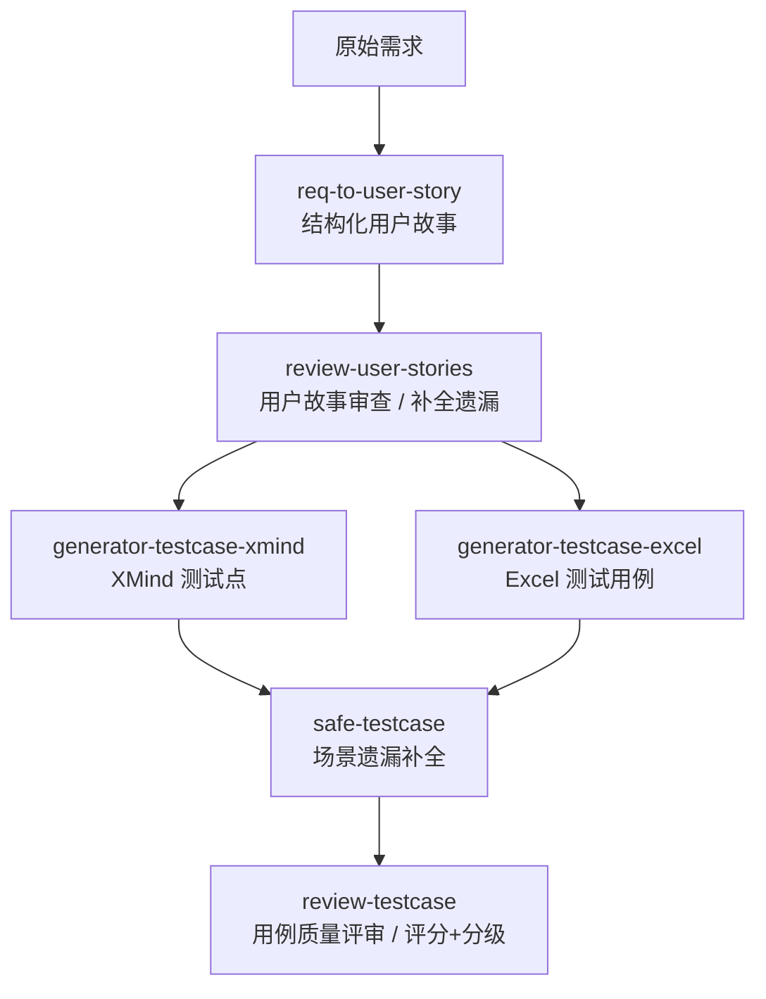
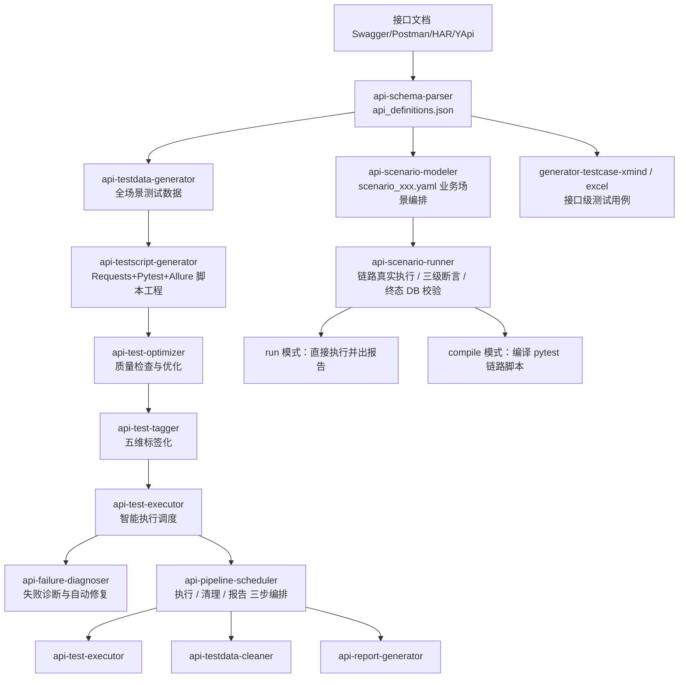
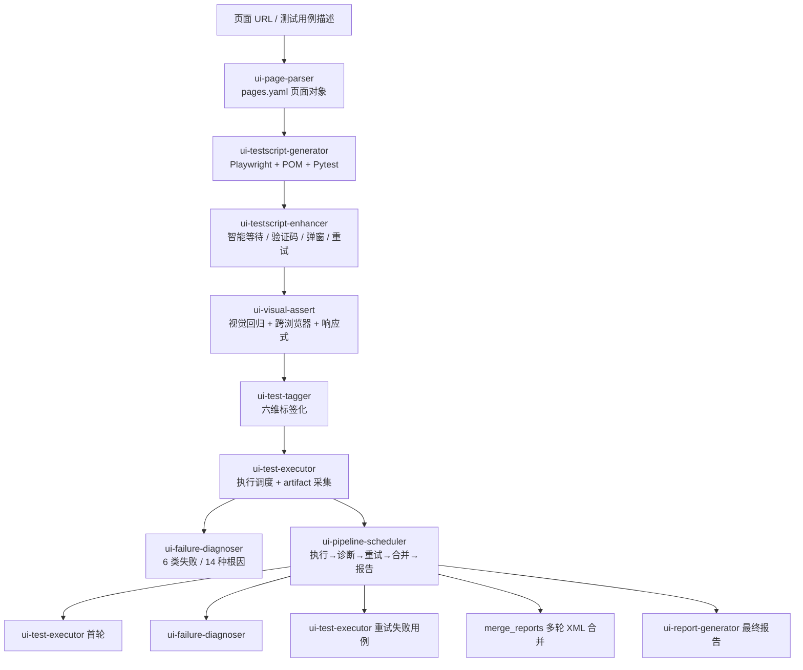

# AI 测试 27 个 Skill 清单索引

## 边界（先读，别踩坑）

- 本技能**只收录公开文章中的技能名称、功能说明与流程关系**，**不含 27 个技能的本体 `SKILL.md`**，也无法调用执行它们。
- 上游作者未公开真实 GitHub 仓库（文中为 `xxx` 占位符）；本体需从 `testfather.cn/skills`（需注册登录）或知识星球「AI 测开进化圈」获取。事实与核验过程见 `SOURCE.md`。
- **严禁把本索引中的功能描述当成已安装能力来使用**。需要某个技能时，先确认本机 `skills` 目录里是否真的存在该目录。
- 技能版权归原作者所有，本包仅整理公开文章的描述性文字，未复制任何未公开内容。

## 何时使用

- 想了解 AI 测试方向有哪些 Agent Skill、各自负责什么环节
- 拿到一个测试任务，想按「需求 → 用例 → 接口 → UI → 报告 → CI」挑对应技能
- 需要向团队介绍一套完整的 AI 测试技能流水线分层
- 想确认某两个技能（如 `api-scenario-modeler` / `api-scenario-runner`）是 25 版之后新增的

## 全景：三组 27 个

| 分组 | 数量 | 覆盖环节 |
| --- | --- | --- |
| 一、需求与用例设计 | 6 | 需求 → 用户故事 → 测试点 / 用例 → 评审 → 补漏 |
| 二、接口自动化 | 12 | 接口定义 → 造数 → 脚本 → 优化 → 打标 → 执行 → 诊断 → 清理 → 报告 → 编排；另有业务场景建模与执行 2 个 |
| 三、UI 自动化 | 9 | 页面解析 → 脚本 → 增强 → 视觉断言 → 打标 → 执行 → 诊断 → 报告 → 编排 |

单拎出来每个都是独立工具，串起来才是完整生产线；链上每个环节皆可独立可用，也支持上下游自动衔接。

## 三条流水线（依据原文流程图重绘）

### 需求分析与测试用例设计

### 接口自动化（单接口 + 业务场景两条线）

### UI 自动化

## 27 个技能速查

完整逐条说明（原文措辞）、原文 ASCII 流程图、版本差异与待补清单见 `README.md`；文章正文忠实转写见 `ARTICLE.md`。

| # | 技能 | 一句话 |
| --- | --- | --- |
| 1 | req-to-user-story | 需求 → 结构化用户故事 |
| 2 | review-user-stories | 用户故事审查，查场景遗漏 |
| 3 | generator-testcase-xmind | 基于用户故事生成 XMind 测试点 |
| 4 | generator-testcase-excel | 转成格式化 Excel 测试用例 |
| 5 | review-testcase | 用例质量分级评审 + 打分 |
| 6 | safe-testcase | 场景遗漏补全 |
| 7 | api-schema-parser | 多来源接口定义统一解析 |
| 8 | api-testdata-generator | 四维度测试数据构造 |
| 9 | api-testscript-generator | 批量生成接口脚本工程 |
| 10 | api-test-optimizer | 脚本四类校验 + 场景补齐 |
| 11 | api-test-tagger | 五维标签化管理 |
| 12 | api-test-executor | 自然语言圈定范围执行 |
| 13 | api-failure-diagnoser | 失败四类归因 + 自动修复 |
| 14 | api-testdata-cleaner | DB / Redis / 临时文件三层清理 |
| 15 | api-report-generator | 可视化 HTML 报告 + Allure 联动 |
| 16 | api-pipeline-scheduler | 执行/清理/报告三步编排 |
| 17 | api-scenario-modeler | 业务链路 → scenario_xxx.yaml |
| 18 | api-scenario-runner | 链路真实执行 + 终态 DB 断言 |
| 19 | ui-page-parser | URL → pages.yaml 页面对象 |
| 20 | ui-testscript-generator | Playwright + POM + Pytest 脚本 |
| 21 | ui-testscript-enhancer | 脚本健壮性增强 |
| 22 | ui-visual-assert | 视觉回归 + 跨浏览器 |
| 23 | ui-test-tagger | 六维标签化管理 |
| 24 | ui-test-executor | UI 执行调度 + 现场采集 |
| 25 | ui-failure-diagnoser | 六类失败十四种根因定位 |
| 26 | ui-report-generator | 单文件 HTML 报告 |
| 27 | ui-pipeline-scheduler | 五步一条龙 + 熔断兜底 |

## 本体获取渠道（2026-11-05 核验）

| 渠道 | 地址 | 状态 |
| --- | --- | --- |
| 作者 GitHub 仓库 | 文中为 `git@github.com:xxx/skills.git` | **占位符，未公开**；GitHub 仓库搜索无结果 |
| Skill 技能商店 | `https://testfather.cn/skills` | 需注册登录，实测页面返回「立即登录」 |
| 知识星球「AI 测开进化圈」 | — | 成员进圈领全套技能包，付费权益 |

拿到本体（zip 或技能目录）后，把它们放进本机 skills 目录即可，并回来更新本索引的「本体已收录」状态。

## 文件说明

| 文件 | 内容 |
| --- | --- |
| `SKILL.md` | 本文件：导航与速查 |
| `README.md` | 27 条完整索引、三条流水线原文图、25→27 版本差异、本体待补清单 |
| `ARTICLE.md` | 公众号原文忠实转写（含全部代码块流程图） |
| `SOURCE.md` | 来源、核验过程、获取渠道事实、免责说明 |
