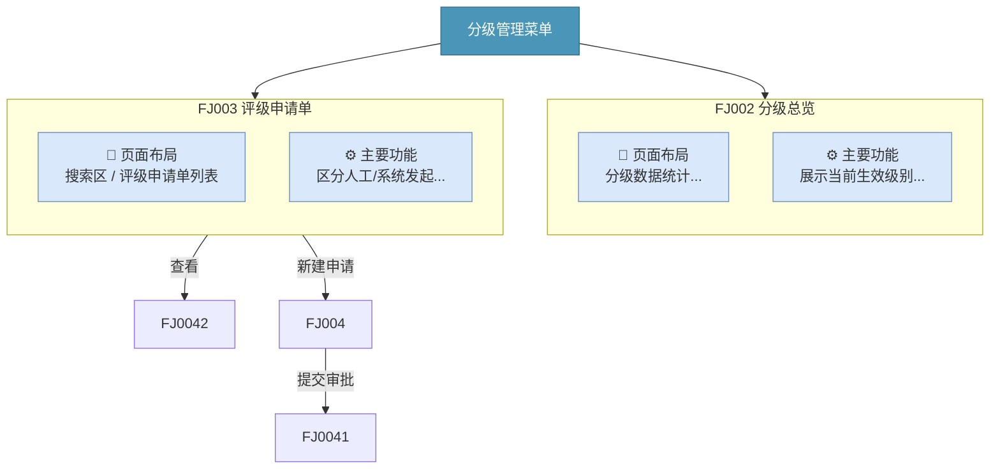
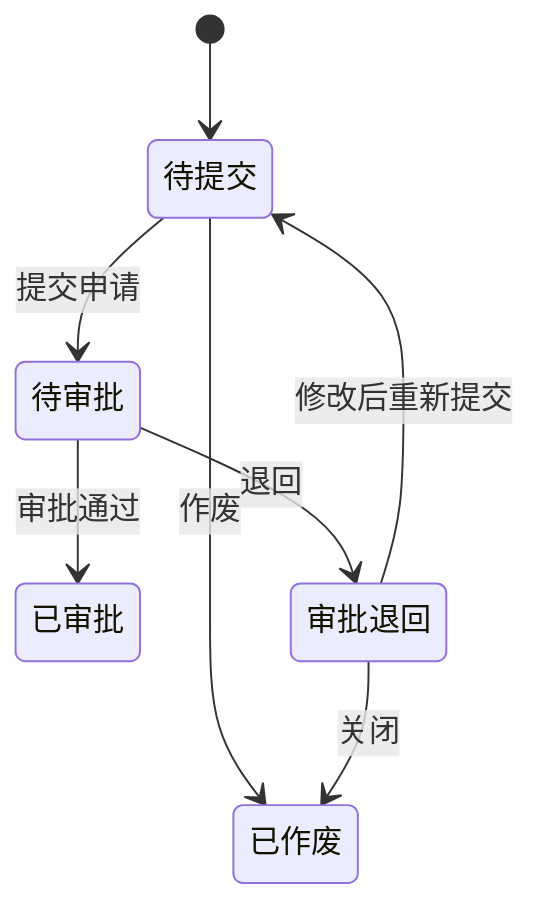
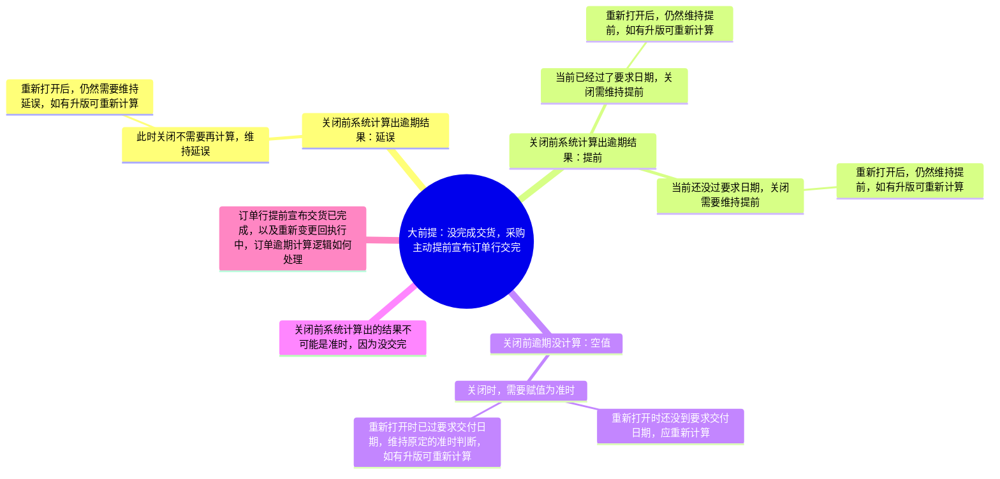
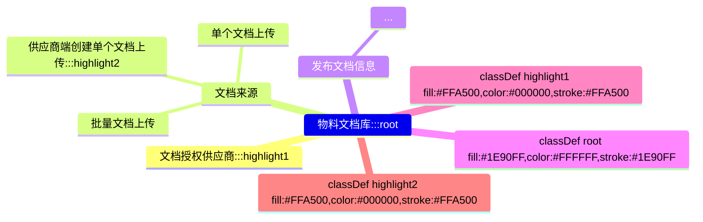
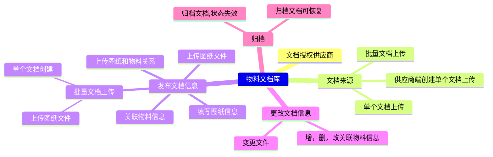

# Case Study：drawio / eddx / xmind 转换实战案例

> 本文件记录三个真实转换案例，作为执行 SKILL.md 三状态流程时的参考模板。
> 案例一、二源文件来自 SRM 2.0 供应商分级 FRD V2 项目；案例三来自 SRM 2.0 订单协同管理项目（2026-08-12 执行）；案例四来自 SRM 2.0 物料文档库 FRD V1 项目（2026-08-12 执行，含 classDef 修正经验）。

---

## 案例一：drawio → Mermaid（页面流转图 + 状态图）

### 输入特征

| 项 | 值 |
|---|---|
| 源文件 | `供应商分级.drawio` |
| 文件大小 | 36 KB |
| 页面数 | 2（页面流转图 / 状态图） |
| 节点数 | 页面流转图 44 / 状态图 10 |
| 连线数 | 页面流转图 7 / 状态图 4 |
| 内部结构 | `<mxfile>` → 2 个 `<diagram name="...">` → `<mxGraphModel><root><mxCell>` |

### 状态 1：目录扫描

```bash
# 扫描结果示例
$ ls *.drawio
供应商分级.drawio   36KB   2022-11-24 19:04
```

用户选择：`供应商分级.drawio`（单选）。

### 状态 2：确认 PRD 信息

用户提供：
- 目标 PRD：`SRM2.0_供应商分级_FRD_V2_20230310.md`
- 插入位置：`#### 供应商分级页面结构` 表格之后、`### 4. 数据流程图` 之前

**经验**：用户对链接位置敏感，先后纠正 3 次。最终位置是「页面结构表格之后、数据流程图之前」。

### 状态 3：转换执行

#### 3.1 解析

```bash
$ python scripts/parse_drawio.py 供应商分级.drawio
=== 供应商分级.drawio 解析完成 ===

[页面] 页面流转图  节点=44 连线=7
--- 节点 ---
  [oVNOH-EOp0iRX1iH_bYr-9] 'FJ005级别设置'
  [oVNOH-EOp0iRX1iH_bYr-24] 'FJ002分级总览'
  ...
--- 连线 ---
  'FJ003评级申请单' -> 'FJ004-2评级申请单—查看'  label='查看'
  'FJ003内部功能' -> 'FJ004评级申请单—创建'  label='新建申请'
  'FJ004评级申请单—创建' -> 'FJ004-1评级申请单—审批'  label='提交审批'

[页面] 状态图  节点=10 连线=4
--- 连线 ---
  '待提交' -> '待审批'
  '待提交' -> '已作废'
  '待审批' -> '已审批'
  '待审批' -> '审批退回'
```

#### 3.2 选型结论

- **页面流转图**：菜单→页面模块层级 + 带标签跳转（查看/新建申请/提交审批）→ **Mermaid flowchart TB**
  - 理由：`subgraph` 天然表达 swimlane 容器层级；箭头 label 表达跳转动作
- **状态图**：状态机（待提交→待审批→已审批/退回/作废）→ **Mermaid stateDiagram-v2**
  - 理由：原生状态机语法，渲染最清晰

#### 3.3 生成代码（关键片段）

页面流转图：


状态图：


#### 3.4 校验

```bash
$ node scripts/validate_uml.mjs 供应商分级.drawio.md
文件: ...   Mermaid块=2  PlantUML块=0
  Mermaid[1]: PARSE OK
  Mermaid[2]: PARSE OK
```

#### 3.5 封装 MD 结构

`供应商分级.drawio.md` 包含：
1. 头部元信息（源文件、选型、图类型、转换时间、校验状态）
2. 一、页面流转图（Mermaid 源码 + 页面模块清单表 + 页面跳转关系表）
3. 二、评级申请单状态图（Mermaid 源码 + 状态说明表）
4. 三、封装信息表（节点数、连线数、选型依据、校验方式）
5. 四、格式检查表

#### 3.6 PRD 插入结果

```markdown
> 📎 UML 源码：[[产品及页面结构图_2]]

> 📎 UML 源码：[[供应商分级.drawio]]（页面流转图 + 评级申请单状态图）  ← 新插入
---
### 4. 数据流程图
```

附录 A 加入 `[[供应商分级.drawio]]`，附录 C 加映射行，附录 D 迭代版本 +1。

### 关键经验

1. **swimlane → subgraph**：drawio 的 swimlane（`style` 含 `swimlane`）对应 Mermaid `subgraph`，子节点的 `parent` 属性指向 swimlane id
2. **连线 label**：drawio edge 的 `value` 即跳转动作（如「查看」「新建申请」），映射为 `-->|label|`
3. **多页 drawio**：一个 drawio 文件可含多个 `<diagram>`，每页独立转一张图，封装在同一 MD
4. **文件名保留扩展名**：`供应商分级.drawio.md`，wikilink `[[供应商分级.drawio]]`
5. **链接位置用户敏感**：先按状态 2 确认的精确位置插入，不要擅自选位

---

## 案例二：eddx → PlantUML（系统架构图）

### 输入特征

| 项 | 值 |
|---|---|
| 源文件 | `供应商分级产品架构图.eddx` |
| 文件大小 | 16 KB |
| 文件格式 | ZIP 包（文件头 `PK\x03\x04`） |
| 内部结构 | `pages/page1.xml`（217 KB XML） + `theme.xml` + `thumbnail.jpeg` |
| Shape 总数 | 64 |
| 节点数 | 38（含文本的非连线 Shape） |
| 连线数 | 22（MMConnector + ConnectLine） |
| Shape 类型分布 | Rectangle 19 / MMConnector 18 / MainTopic 5 / SubTopic 13 / MainIdea 1 / ConnectLine 4 / TextBlock 4 |

### 状态 1：目录扫描

```bash
$ ls *.eddx
供应商分级产品架构图.eddx   16KB   2022-11-24 19:04
```

用户选择：`供应商分级产品架构图.eddx`。

### 状态 2：确认 PRD 信息

用户提供：
- 目标 PRD：`SRM2.0_供应商分级_FRD_V2_20230310.md`
- 插入位置：`3. 产品及页面结构图 - 供应商分级产品结构图` 与 `#### 供应商分级页面结构` 之间

### 状态 3：转换执行

#### 3.1 解析

```bash
$ python scripts/parse_eddx.py 供应商分级产品架构图.eddx
=== 供应商分级产品架构图.eddx 解析完成 ===
Shape 总数: 64  节点: 38  连线: 22

--- 节点 ---
  [142] Rectangle    '品类定位'
  [141] Rectangle    '供应商绩效'
  [144] Rectangle    '数据来源'
  [145] Rectangle    '数据处理'
  [102] MainTopic    '级别设置'
  [112] SubTopic     '级别名称，级别升降条件设置及显示'
  [101] MainIdea     '供应商分级'
  [150] Rectangle    '供应商+品类+采购组织+供应商级别 S0:海选供应商...'
  [153] Rectangle    '询报价'
--- 连线 ---
  [103] MMConnector  super=101
  [113] MMConnector  super=102
```

**解析陷阱**：
- 文本在 `<Text><pp><tp>文本</tp></pp></Text>` 中，会重复出现（TextBlock 与 Shape 重复），必须去重
- 用 `xml.etree.ElementTree` 而非正则（Shape 可嵌套，正则非贪婪会截断）
- MMConnector 通过 `<LevelData><SuperLevel V="父ID">` 表达父级，不是 source/target

#### 3.2 选型结论

- **系统架构图（四阶段分层）**：数据来源→数据处理→数据输出→数据应用 → **PlantUML component diagram**
  - 理由：`package` 表达四阶段容器，`rectangle` 表达模块，`note` 挂载详细信息，依赖箭头表达数据流向

#### 3.3 生成代码（关键片段）

```plantuml
@startuml 供应商分级产品架构图
!theme plain
skinparam rectangle { RoundCorner 15 }

package "数据来源" #A9C7E8 {
  rectangle "品类定位" as SRC1
  rectangle "供应商绩效" as SRC2
  rectangle "供应商认证" as SRC3
  rectangle "供应商资源库" as SRC4
  rectangle "战略" as SRC5
}

package "数据处理" #C6E0B4 {
  rectangle "供应商分级" as CORE #D9EAD3

  package "级别设置" as CFG #E2EFDA {
    rectangle "级别名称、级别升降条件设置及显示" as CFG1
    rectangle "评级周期设置" as CFG2
  }
  package "级别推荐" as REC #E2EFDA {
    rectangle "自动推荐" as REC1
    rectangle "手动推荐" as REC2
  }
}

package "数据输出" #F8CBAD {
  rectangle "供应商+品类+采购组织+供应商级别" as OUT
  note right of OUT
    S0: 海选供应商
    S1: 潜在供应商
    ...
  end note
}

package "数据应用" #D9C3E7 {
  rectangle "询报价" as APP1
  rectangle "订单协同" as APP2
}

SRC1 --> CORE : 品类定位
SRC2 --> CORE : 绩效等级
CORE --> OUT
OUT --> APP1
@enduml
```

#### 3.4 校验

```bash
$ node scripts/validate_uml.mjs 供应商分级产品架构图.eddx.md --online
文件: ...   Mermaid块=0  PlantUML块=1
  PlantUML[1]: RENDER OK (27996 chars)
```

**关键节点核对**（AI 主动执行，非脚本）：
```python
for kw in ['数据来源','数据处理','数据输出','数据应用','供应商分级',
          '级别设置','级别推荐','评级','级别展示','级别分析',
          '询报价','订单协同','BI','采购战略','品类定位',
          '供应商绩效','供应商认证','供应商资源库','战略','S0','S7','BL']:
    print('✓' if kw in svg else '✗', kw)
# 全部 ✓（22/22 命中）
```

#### 3.5 封装 MD 结构

`供应商分级产品架构图.eddx.md` 包含：
1. 头部元信息
2. 一、PlantUML 源码
3. 二、原始图（参考）：源文件说明 + ASCII 图结构示意（四阶段分层）
4. 三、封装信息表（节点数 27、连线数 15、分组层级 4、选型依据）
5. 四、格式检查表

#### 3.6 PRD 插入结果

```markdown
#### 供应商分级产品结构图
> 📎 UML 源码：[[产品及页面结构图_1]]

> 📎 UML 源码：[[供应商分级产品架构图.eddx]]   ← 新插入
#### 供应商分级页面结构
```

附录 A 加入 `[[供应商分级产品架构图.eddx]]`，附录 C 加映射行，附录 D 迭代版本 +1。

### 关键经验

1. **eddx = ZIP 包**：必须先解压才能解析，`parse_eddx.py` 已自动处理（用 tempfile + zipfile）
2. **文本去重**：eddx 中 TextBlock 与 Shape 重复出现同一文本，`txt_of()` 用 `seen` set 去重
3. **XML 树解析**：用 `xml.etree.ElementTree` 而非正则，避免 Shape 嵌套导致截断
4. **PlantUML note 多行**：用 `note right of X` + `end note` 挂载详细信息（如级别清单 S0-S7）
5. **配色方案**：四阶段用不同浅色（蓝/绿/橙/紫），通过 `package "..." #A9C7E8` 指定
6. **PlantUML 在线校验**：`~h` + utf-8 hex 编码最稳定，URL 长度无限制
7. **关键节点核对**：渲染 SVG 后用 `for kw in [...]: '✓' if kw in svg else '✗'` 逐节点核对，确保转换完整

---

## 案例三：xmind → Mermaid mindmap（思维导图）

### 输入特征

| 项 | 值 |
|---|---|
| 源文件 | `订单状态变更对逾期计算的影响.xmind` |
| 文件大小 | 213 KB |
| 文件格式 | ZIP 包（文件头 `PK\x03\x04`） |
| 内部结构 | `content.json`（现代版本，1 个 sheet）+ `metadata.json` + `Thumbnails/` |
| Sheet 数 | 1（画布 1） |
| 节点数 | 14 |
| 深度 | 4 层决策树 |

### 状态 1：目录扫描

```bash
$ ls *.xmind
订单状态变更对逾期计算的影响.xmind   213KB   2026-05-18 20:51
```

用户选择：`订单状态变更对逾期计算的影响.xmind`。

> **注意**：xmind 不在旧版 skill（drawio-eddx-to-uml-prd）支持范围，本次使用升级版 xum2md 的 `parse_xmind.py` 处理。

### 状态 2：确认 PRD 信息

用户提供：
- 目标 PRD：`SRM 2.0_订单协同管理_FRD_V2.md`
- 插入位置：`## 11. 数据模型` 章节（状态流转/逾期计算相关）

### 状态 3：转换执行

#### 3.1 解析

```bash
$ python scripts/parse_xmind.py 订单状态变更对逾期计算的影响.xmind
=== 订单状态变更对逾期计算的影响.xmind 解析完成 ===
Sheet 数: 1

[Sheet] 画布 1  节点=14  深度=4
--- 节点树 ---
[fd9b11b68b6913882d60898f92] '大前提：没完成交货，采购主动提前宣布订单行交完'
  [9c28110c748981bb818baa4d92] '关闭前系统计算出了逾期结果：延误。表示已经过了要求交货日期，还没交完，采购不需要剩余数量。'
    [484271c3-2e7f-418b-adc8-22a86a5fb1c8] '此时关闭不需要再计算，维持延误。'
      [124e22d2-4e28-4658-8004-811607d06d1e] '重新打开后，仍然需要维持延误，如有升版可重新计算'
  [51415fdf-61b1-4540-9295-c63a86320d30] '关闭前系统计算出了逾期结果：提前。表示在要求交货日期前就已经开始交付了，但是还没交完。'
    ...
```

**解析要点**：
- 优先读 `content.json`（结构化 JSON，`rootTopic.title` / `children.attached[]` 递归），旧版 xmind 才回退 `content.xml`
- 个别版本 `title` 是富文本对象（dict），脚本已自动取 `.text`

#### 3.2 选型结论

- **决策树型思维导图**：单一中心节点向外发散、分支条件是"关闭前逾期结果（延误/提前/空值）" → **Mermaid mindmap**
  - 理由：保持树形层级最忠实，mindmap 原生支持中心辐射

#### 3.3 生成代码（关键片段）



#### 3.4 校验

```bash
$ node scripts/validate_uml.mjs 订单状态变更对逾期计算的影响.xmind.md
文件: ...   Mermaid块=1  PlantUML块=0
  Mermaid[1]: PARSE OK
```

#### 3.5 封装 MD 结构

`订单状态变更对逾期计算的影响.xmind.md` 包含：
1. 头部元信息
2. 一、Mermaid 源码
3. 二、原始图（参考）：源文件说明 + 决策树结构示意
4. 三、封装信息表（节点数 14、深度 4、选型依据）
5. 四、格式检查表

#### 3.6 PRD 插入结果

```markdown
## 11. 数据模型
> 📎 UML 源码：[[订单管理-状态流转图]]
> 📎 UML 源码：[[订单状态变更对逾期计算的影响]]   ← 新插入
```

附录 A 加入 `[[订单状态变更对逾期计算的影响.xmind]]`，附录 C 加映射行，附录 D 迭代版本 +1。

### 关键经验

1. **xmind = ZIP 包**：必须先解压，`parse_xmind.py` 已自动处理（zipfile + content.json/content.xml 双格式）
2. **单一 root 约束**：Mermaid mindmap 只允许一个根。若 xmind 有多个 sheet 或多个中心主题，必须加总根（如 `root((订单协同功能结构))`），否则报 `There can be only one root`（在订单管理-按需交付协同功能结构案例中已踩坑）
3. **title 富文本**：部分 xmind 版本 `title` 是 dict（`{"text": "..."}`），需取 `.text`
4. **特殊字符**：`(`/`)`/`*` 等保留字风险，转换时注意清洗
5. **Mermaid 本地校验**：mindmap 用本地 `mermaid.parse` 即可，无需 `--online`

---

## 案例四：xlsx 内嵌图片 → Mermaid mindmap（含 classDef 修正经验）

### 输入特征

| 项 | 值 |
|---|---|
| 源文件 | `SRM 2.0_订图纸库_FRD_V1_ 20220712.xlsx` 中"功能清单-脑图"sheet 内嵌图片 |
| 图片文件 | `功能清单-脑图_1.png`（46 KB，1194×524 px） |
| 图片来源 | xlsx `_images` 属性（openpyxl `ws._images[0]`） |
| 节点数 | 17（中心 1 + 一级分支 5 + 二级分支 11） |
| 深度 | 3 层 |

### 状态 1：目录扫描

非标准输入（xlsx 内嵌图片，非 .drawio/.eddx/.xmind）。通过 xlsx2prd skill 的 Step 1 解析 xlsx 时提取 `_images`，保存为 PNG 后按 xum2md 流程转换。

### 状态 2：确认 PRD 信息

- 目标 PRD：`SRM 2.0_订图纸库_FRD_V1_ 20220712.md`
- 插入位置：`### 3. 功能清单-脑图` 章节

### 状态 3：转换执行

#### 3.1 解析

无 `parse_xmind.py` 可用（源是 PNG 图片非 xmind 文件），通过 AI 多模态识别图片内容提取节点树。

#### 3.2 选型结论

- **思维导图（中心辐射树）**：中心节点"物料文档库"向外发散 5 个一级分支 → **Mermaid mindmap**

#### 3.3 生成代码（初版 — 含 classDef，后被修正）



#### 3.4 校验

```bash
$ node step5c_mermaid.mjs
PARSE_OK: { diagramType: 'mindmap', config: {} }
```

语法校验通过，但用户指出 classDef 部分不应存在。

#### 3.5 原图颜色分析（PIL 像素统计）

用 Python PIL 对原图做像素级颜色分析：

```python
from PIL import Image
from collections import Counter
img = Image.open('功能清单-脑图_1.png').convert('RGB')
pixels = list(img.getdata())
counter = Counter(pixels)
# 输出 top 颜色
```

| 颜色 | RGB | 占比 | 位置（bbox） | 对应节点 |
|---|---|---|---|---|
| 蓝色填充 | #5A97FB | 1.70% | 中心区域 (x=400-600, y=200-280) | 物料文档库（根节点） |
| 黄色填充 | #FFC000 | 1.86% | 左上 (x=150-333, y=150-200) + 左下 (x=10-182, y=310-360) | 2 个一级分支 |
| 红色文字 | #C00000 | 0.19% | 黄色区域内 | 黄色节点内的文字 |
| 白色背景 | #FFFFFF | 92.28% | — | — |
| 深灰文字 | #303030 | 0.63% | 全图 | 普通节点文字 |

**发现问题**：
1. 初版 classDef 用的颜色（`#1E90FF`、`#FFA500`）与原图实际颜色（`#5A97FB`、`#FFC000`）不匹配
2. 初版标记的高亮节点（文档授权供应商、供应商端创建单个文档上传）是 AI 猜测的，实际黄色节点在左侧，无法在无 OCR 的情况下精确对应
3. classDef 和 `:::className` 标记出现在分支节点文本中，违反分支节点文本纯净性规则

#### 3.6 修正代码（最终版 — 纯树形结构）



#### 3.7 封装 MD 结构

`功能清单-脑图_1.md` 包含：
1. 头部元信息
2. 一、原始图片（参考）
3. 二、Mermaid 源码（纯树形，无 classDef）
4. 三、原图颜色分析（PIL 像素统计表 + 颜色未还原说明）
5. 四、格式检查（含 classDef = N/A）
6. 五、语法检查

### 关键经验

1. **mindmap 分支节点文本纯净性（本案例核心教训）**：mindmap 分支节点文本中**不得包含**颜色色号（`#FFC000`）、unicode 转义（`\u66f4`）、样式标记（`:::className`）、classDef 定义行。这些"代码"内容会污染节点文本，且无法准确还原原图颜色。已纳入 `conversion-guide.md` 映射要点第 6 条和验收清单第 3 条。
2. **原图颜色分析用 PIL 像素统计**：当源文件是图片（非 xmind/drawio/eddx）时，用 `PIL.Image` + `collections.Counter` 做像素级颜色统计，可精确获取原图的 RGB 分布、占比、位置（bbox），作为是否还原颜色的决策依据。
3. **颜色无法精确对应时保持纯树形**：原图有颜色但无法确定哪个节点对应哪种颜色时（如无 OCR），保持纯树形结构，在封装 MD 中记录颜色分析结果。不要猜测 — 猜测的颜色和节点比没有更糟糕。
4. **mindmap 默认不用 classDef**：与 flowchart 不同，mindmap 的 classDef 对节点样式的支持有限，且容易在分支中引入代码污染。仅在能逐节点核对确认颜色的前提下才使用。
5. **`root` 不是 Mermaid 保留字**：`root((标题))` 中的 `root` 是节点名 + 圆形形状 `((...))`，非保留字。但推荐直接用纯文本作为根节点以保持简洁（已修正 `conversion-guide.md` 通用规则）。

---

## 四个案例对比

| 维度 | 案例一 drawio | 案例二 eddx | 案例三 xmind | 案例四 xlsx 内嵌图片 |
|---|---|---|---|---|
| 文件格式 | 纯 XML（压缩三层编码） | ZIP 包 | ZIP 包 | PNG 图片（xlsx 内嵌） |
| 解析方式 | ET + base64/deflate/url 解码 | zipfile 解压后 ET | zipfile → content.json | AI 多模态识别 + PIL 像素分析 |
| 图类型 | 页面流转图 + 状态图 | 系统架构图（四阶段分层） | 决策树思维导图 | 功能清单思维导图 |
| 选型 | Mermaid flowchart + stateDiagram-v2 | PlantUML component | Mermaid mindmap | Mermaid mindmap |
| 容器表达 | `subgraph` | `package` | 树缩进 | 树缩进 |
| 模块表达 | 节点 `[文本]:::class` | `rectangle "文本" as ID` | `标题` 行 | `标题` 行 |
| 连线表达 | `-->|label|` | `--> : label` | 父子缩进 | 父子缩进 |
| 详细信息 | 节点 label 内 `<br>` | `note right of X` | 子节点展开 | 子节点展开 |
| 校验方式 | mermaid.parse 本地 | plantuml.com 在线 HEX | mermaid.parse 本地 | mermaid.parse 本地 |
| 节点核对 | 不需要 | 必须（SVG 命中） | 不需要（树即层级） | 不需要（树即层级） |
| classDef | 使用（flowchart 区分节点类型） | 不使用（PlantUML 用 skinparam） | 不使用（纯树形） | 不使用（纯树形，初版用了但已修正） |
| 颜色还原 | classDef | skinparam + package 颜色 | 不还原 | 不还原（PIL 分析后记录在封装 MD 中） |

---

## 复现步骤

```bash
# 案例一：drawio → Mermaid
python scripts/parse_drawio.py 供应商分级.drawio --out drawio.json
# AI 基于 JSON 生成 Mermaid 代码 → 写入 供应商分级.drawio.md
node scripts/validate_uml.mjs 供应商分级.drawio.md

# 案例二：eddx → PlantUML
python scripts/parse_eddx.py 供应商分级产品架构图.eddx --out eddx.json
# AI 基于 JSON 生成 PlantUML 代码 → 写入 供应商分级产品架构图.eddx.md
node scripts/validate_uml.mjs 供应商分级产品架构图.eddx.md --online
# AI 主动用 plantuml.com SVG 核对关键节点

# 案例三：xmind → Mermaid mindmap
python scripts/parse_xmind.py 订单状态变更对逾期计算的影响.xmind --out xmind.json
# AI 基于 JSON 生成 Mermaid mindmap 代码 → 写入 订单状态变更对逾期计算的影响.xmind.md
node scripts/validate_uml.mjs 订单状态变更对逾期计算的影响.xmind.md

# 案例四：xlsx 内嵌图片 → Mermaid mindmap
# 1. 用 openpyxl 提取 xlsx 中的图片
python -c "import openpyxl; wb=openpyxl.load_workbook('SRM 2.0_订图纸库_FRD_V1_ 20220712.xlsx'); ws=wb['功能清单-脑图']; open('功能清单-脑图_1.png','wb').write(ws._images[0]._data())"
# 2. AI 多模态识别图片内容 → 生成 Mermaid mindmap 代码（纯树形，无 classDef）
# 3. PIL 像素分析原图颜色 → 记录在封装 MD 中
python -c "from PIL import Image; from collections import Counter; img=Image.open('功能清单-脑图_1.png').convert('RGB'); print(Counter(img.getdata()).most_common(10))"
# 4. 语法校验
node scripts/validate_uml.mjs 功能清单-脑图_1.md
# 5. 分支节点纯净性检查（正则扫描）
python -c "import re; code=open('功能清单-脑图_1.md').read(); assert not re.search(r'#[0-9A-Fa-f]{6}',code), '含颜色色号'; assert not re.search(r':::\w+',code), '含样式标记'; print('纯净性检查通过')"
```
