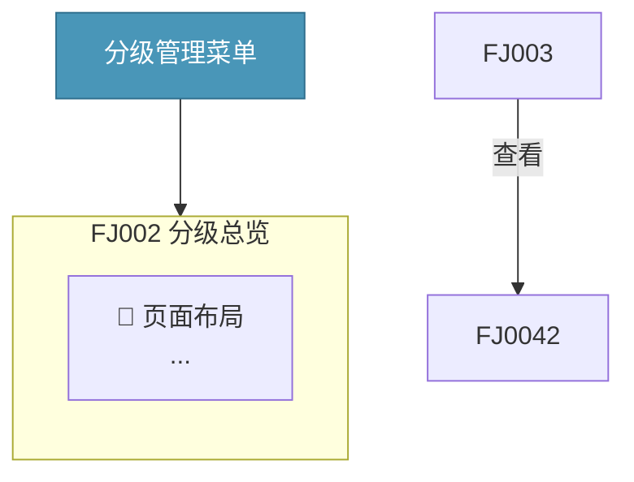
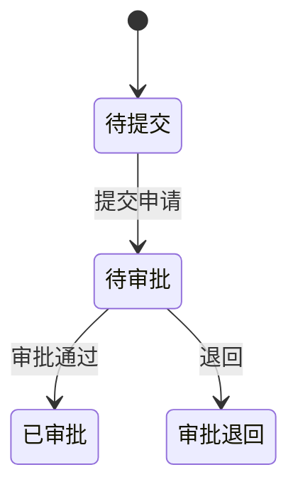
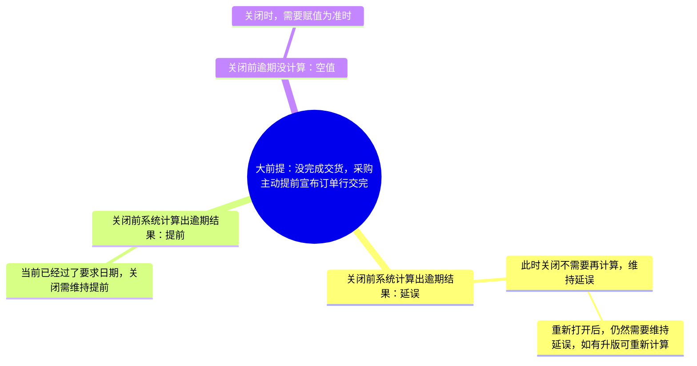

# Conversion Guide：drawio/eddx/xmind → UML → 封装 MD

完整转换方法参考。配合 SKILL.md 三状态流程使用。

## 一、文件格式判定与解析

| 格式 | 判定方法 | 内部结构 | 解析方式 |
|---|---|---|---|
| `.drawio` | 纯 XML，根节点 `<mxfile>` | 含 1+ 个 `<diagram name="...">` 页；每页 `<mxGraphModel><root><mxCell>`。⚠️ **默认压缩格式**：`<diagram>` 内容为 base64 → deflate → urlencode 三层编码 | `xml.etree.ElementTree`；先用 `parse_drawio.py` 的内置 `decode_diagram()` 解码后再解析；`mxCell` 中 `vertex=1` 为节点，`edge=1` 为连线 |
| `.eddx` | ZIP 包，文件头 `PK\x03\x04` | `pages/page1.xml`（图形数据）+ `theme.xml` + `thumbnail.jpeg` | 先 `unzip`，再解析 XML |
| `.xmind` | ZIP 包，文件头 `PK\x03\x04` | `content.json`（现代版本，结构化 JSON）+ `metadata.json` + `Thumbnails/`；旧版为 `content.xml` | 先 `unzip`，优先解析 `content.json`（缺失回退 `content.xml`） |

### drawio 关键字段

| XML 元素/属性 | 含义 |
|---|---|
| `<diagram name="页面流转图">` | 图页名（可作为 MD 子标题） |
| `mxCell` `value` | 节点文本（可能含 HTML：`<p>`/`<br>`，需去标签） |
| `mxCell` `edge="1"` + `source`/`target` | 连线：source→target，指向其他 mxCell 的 id |
| `mxCell` `style` 含 `swimlane` | 泳道容器（页面模块，子节点 parent 指向它） |
| `mxCell` `parent` | 父子层级（容器 → 子节点） |

### eddx 关键字段

| XML 元素/属性 | 含义 |
|---|---|
| `<Shape Type="Rectangle|MainTopic|SubTopic|MainIdea|ConnectLine|MMConnector|TextBlock">` | 节点类型 |
| `<Shape ID="...">` | 节点唯一 ID |
| `<Text><pp><tp>文本</tp></pp></Text>` | 节点文本（注意：文本会出现在多个层级，需去重） |
| `<ShapeFormat><LineFormat><BeginArrow/EndArrow>` | 是否箭头（连线特征） |
| `<CPoints><BeginX/BeginY/EndX/EndY>` | 连线坐标 |
| `<LevelData><SuperLevel V="父ID"/>` | MMConnector 的父级（层级树） |
| MainIdea→MainTopic→SubTopic | 思维导图层级（脑图结构） |

**文本提取注意**：eddx 中同一文本会出现在 TextBlock 和 Shape 两个位置，必须去重；用 `xml.etree.ElementTree` 遍历 `<tp>` 收集文本。

### xmind 关键字段（content.json）

| JSON 字段 | 含义 |
|---|---|
| 顶层数组（每项一个 sheet） | 工作簿/画布，`title` 为画布名 |
| `rootTopic` | 中心主题（思维导图根节点） |
| `rootTopic.title` | 根节点文本 |
| `rootTopic.children.attached[]` | 一级分支（递归：每个分支又有 `children.attached[]`） |
| `id` | 节点唯一 ID |

**旧版 content.xml 结构**：`<xmap-content><sheet><topic id="" title="">`，`<children><topics type="attached"><topic>...` 递归嵌套，语义与 content.json 相同。

**解析注意**：优先读 `content.json`（现代 xmind 默认），缺失才回退 `content.xml`；`title` 个别版本为富文本对象（dict），需取 `.text`。

## 二、选型表（PlantUML vs Mermaid）

| 图形类型 | 特征 | 选型 | 备注 |
|---|---|---|---|
| 模块架构 / 组件依赖 / 系统分层 | 分层分组（数据来源→数据处理→数据输出→数据应用）、模块依赖箭头、无严格时序 | **PlantUML component** | `package` + `rectangle` + 依赖箭头 |
| 页面流转 / 页面导航 | 菜单→页面模块→功能层级 + 带标签跳转（查看/新建申请） | **Mermaid flowchart** | `subgraph` 表达页面容器 |
| 状态机 / 状态流转 | 待提交→待审批→已审批/退回/作废 | **Mermaid stateDiagram-v2** | 原生状态机语法 |
| 业务流程图 / 决策 | 有方向箭头、分支决策（if/else） | **Mermaid flowchart** | 决策节点 |
| 思维导图 / 中心辐射 | 单一中心节点向外发散 | **Mermaid mindmap** | |
| 时序 / 消息交互 | participant 之间消息 | **PlantUML sequence** | |

**输出选型结论**：转换开始前先陈述"图类型 + 选型理由 + 目标格式"，再写代码。

## 三、语法映射要点

### 通用
- 中文文案原样保留
- 避免 PlantUML 保留字：`history`, `deepHistory`, `start`, `end`, `fork`, `join`, `choice`, `entry`, `exit`（`<<history>>` → `<<hist>>`）
- Mermaid mindmap 根节点：第一行缩进节点即为根节点，无需 `root` 关键字。`root((标题))` 写法可用（`root` 非保留字，`((...))` 是圆形形状），但推荐直接用纯文本作为根节点以保持简洁
- classDef：仅在 flowchart 等需要区分节点类型的图中使用；mindmap 默认不使用 classDef（见下方 mindmap 映射要点第 6 条）
### drawio → Mermaid flowchart


### drawio → Mermaid stateDiagram-v2


### eddx → PlantUML component
```plantuml
@startuml 供应商分级产品架构图
!theme plain
skinparam rectangle { RoundCorner 15 }

package "数据来源" #A9C7E8 {
  rectangle "品类定位" as SRC1
}
package "数据处理" #C6E0B4 {
  rectangle "供应商分级" as CORE
}
SRC1 --> CORE : 品类定位
@enduml
```

### xmind → Mermaid mindmap


**xmind → mindmap 映射要点**：
1. **单一 root 约束（最关键）**：Mermaid mindmap 只允许一个根节点。多 sheet 或多中心主题时，必须加一个总根（如 `root((订单协同功能结构))`），原各中心主题降为一级分支；直接并列多个 `root((...))` 会报 `There can be only one root` 错误。
2. **层级对应**：`rootTopic` → `root((标题))`，`children.attached[]` 递归降级为子行，缩进用 2 空格递增。
3. **文本清洗**：标题中的 `(`/`)`/`*`/`/`/`:` 等特殊字符在 mindmap 中可能引发解析歧义，转换时对极端字符做保留字规避（优先保持原意，必要时替换为全角或删除）。
4. **中文标题**：原样保留，禁止 `\uXXXX` 转义。
5. **决策树语义**：若思维导图是"分支条件→结论"的决策树（如本案例逾期计算），保持树形即可；无需强行转 flowchart。若用户明确要求展示决策流向，可转 `flowchart`。
6. **分支节点文本纯净性（硬性规则）**：mindmap 分支节点文本中**不得包含**任何"代码"内容：
   - ❌ 颜色色号：`#FFC000`、`#1E90FF` 等（`#[0-9A-Fa-f]{6}` 模式）
   - ❌ unicode 转义序列：`\u66f4` 等（`\\u[0-9a-fA-F]{4}` 模式）
   - ❌ 样式标记：`:::className`（如 `:::root`、`:::highlight1`）
   - ❌ classDef 定义行：`classDef root fill:...`
   
   原图如有颜色高亮，应在封装 MD 的"原图颜色分析"章节中记录颜色 RGB、占比、位置，**不要在 mindmap 代码中硬编码颜色**。若必须还原颜色，需满足全部条件：① 与原图逐节点核对确认哪个节点是哪种颜色；② 使用 `:::className` + 块内末尾 `classDef`；③ 在封装 MD 中附上颜色对照表。无法精确对应时，保持纯树形结构。
   
   **检测方法**：转换完成后，用正则扫描 mindmap 代码块：
   ```python
   import re
   # 颜色色号
   assert not re.search(r'#[0-9A-Fa-f]{6}', code), '分支中含颜色色号'
   # unicode 转义
   assert not re.search(r'\\u[0-9a-fA-F]{4}', code), '分支中含 unicode 转义'
   # 样式标记
   assert not re.search(r':::\w+', code), '分支中含样式标记'
   # classDef 定义行
   assert not re.search(r'^\s*classDef\s', code, re.M), '含 classDef 定义行'
   ```

## 四、语法校验（降级链）

| 工具 | 校验方式 | 失败降级 |
|---|---|---|
| Mermaid | `scripts/validate_uml.mjs`（mermaid.parse + jsdom，本地） | 跳过+标记 ⚠️ |
| PlantUML | `scripts/validate_uml.mjs`（本地 `@plantuml/core` → 在线 plantuml.com 降级） | 在线失败 → 跳过+标记 ⚠️ |

**PlantUML 校验降级链（validate_uml.mjs 已内置）**：
1. **本地 `@plantuml/core`**：`npm install` 后可用，离线校验语法。
   ⚠️ **已知局限**：Windows + jsdom 环境缺 SVG `getBBox`，渲染阶段报 `textEl.getBBox is not a function`，属渲染环境问题而非语法错误——脚本会将此类判定为 `render-only` 并**自动降级在线**。若本地不可用或不可靠，不要手工干预，直接信任在线结果。
2. **在线 plantuml.com**：`--online` 强制在线，或本地失败时自动降级。`~h` + utf-8 hex 编码最稳定。

**PlantUML 在线渲染 URL**（~h = HEX 编码，最稳定）：
```python
h = code.encode('utf-8').hex()
url = f'https://www.plantuml.com/plantuml/svg/~h{h}'
```

**校验通过后的节点核对（AI 主动执行，非脚本）**：
- PlantUML：用上述 URL 获取 SVG，检查 SVG 文本中是否包含源文件全部关键节点文本（用 `for kw in [...]: '✓' if kw in svg else '✗'` 核对）。缺失则修复代码并重试，≤3 轮。
- Mermaid：本地 `parse` 仅校验语法；视觉核对需 mermaid.ink 在线渲染（可选）。

## 五、封装 MD 模板

生成 `{源文件名}.md`（如 `供应商分级.drawio.md`、`供应商分级产品架构图.eddx.md`），输出到 PRD 同目录的 `md版本文档整理/`：

```markdown
# {源文件名}（{drawio|eddx} 源码转换）

> 本文件对应源文件：`{源文件名}`
> 转换选型：**{PlantUML|Mermaid}**
> 图类型：{系统架构图|页面流转图|状态图|...}
> 转换时间：{ISO 8601}
> 语法校验：✅ 通过 / ⚠️ 待人工确认

---

## 一、{PlantUML|Mermaid} 源码

```{plantuml|mermaid}
（转换代码）
```

## 二、原始图（参考）

（源文件说明 + ASCII 图结构示意）

## 三、封装信息（转换元数据）

| 项 | 值 |
| --- | --- |
| 源文件 | {文件名} |
| 节点数 | N |
| 连线数 | M |
| 分组层级 | ... |
| 选型 | ... |
| 选型依据 | ... |
| 校验方式 | ... |
| 校验结果 | ✅/⚠️ + 关键节点命中情况 |

## 四、格式检查

| 项 | 值 |
| --- | --- |
| 文件名 | {源文件名}.md |
| 代码块标识 | {plantuml|mermaid} |
| 中文字符 | 已验证 |
| 行尾 | LF |
```

**硬性要求**：所有输出文件 UTF-8 无 BOM、LF 换行（`open(path, "w", encoding="utf-8", newline="\n")`）。

## 六、验收清单

1. 源文件全部节点/连线在 UML 代码中有体现（逐节点文本命中）
2. 语法校验通过（或已标记 ⚠️ 待人工确认）
3. **分支节点文本纯净性**：mindmap 分支中无颜色色号（`#XXXXXX`）、unicode 转义（`\uXXXX`）、样式标记（`:::class`）、classDef 定义行（仅 mindmap 适用，见映射要点第 6 条）
4. 封装 MD 含完整封装信息表
5. 主 PRD 链接已插入指定章节，附录 A/C/D 已同步
6. 所有文件 UTF-8 无 BOM、LF 换行
